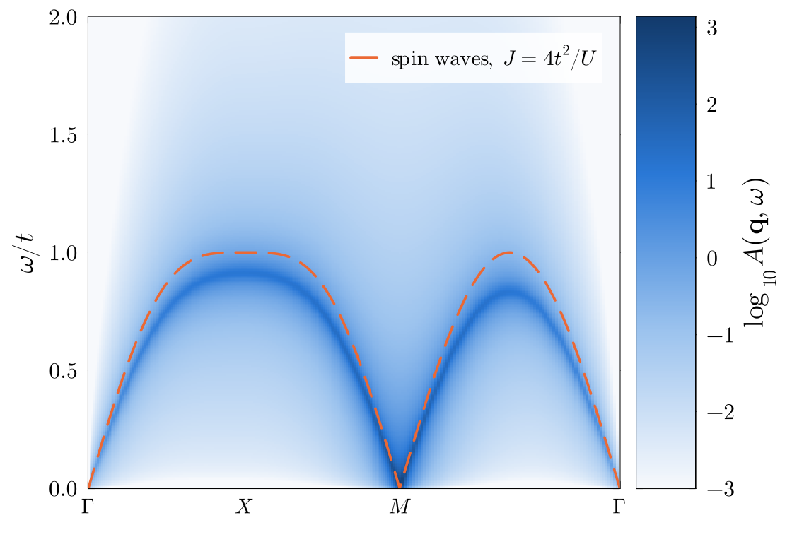
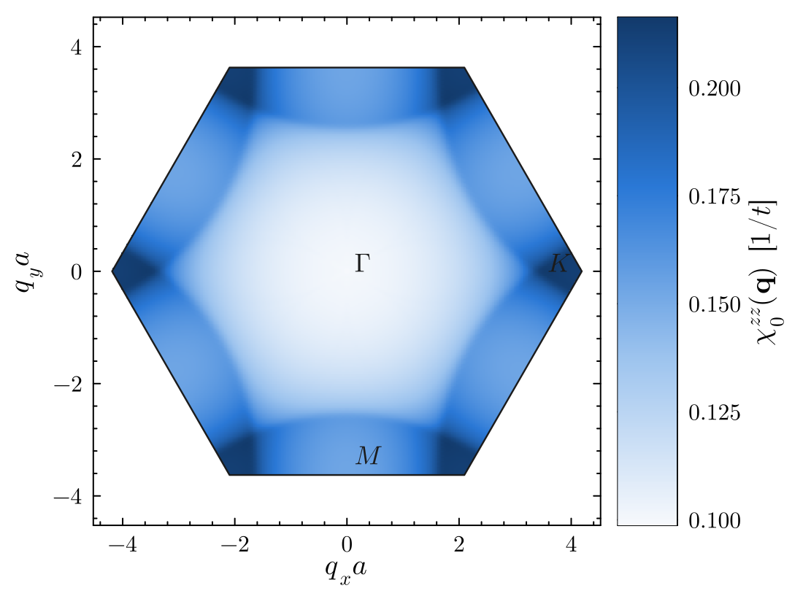
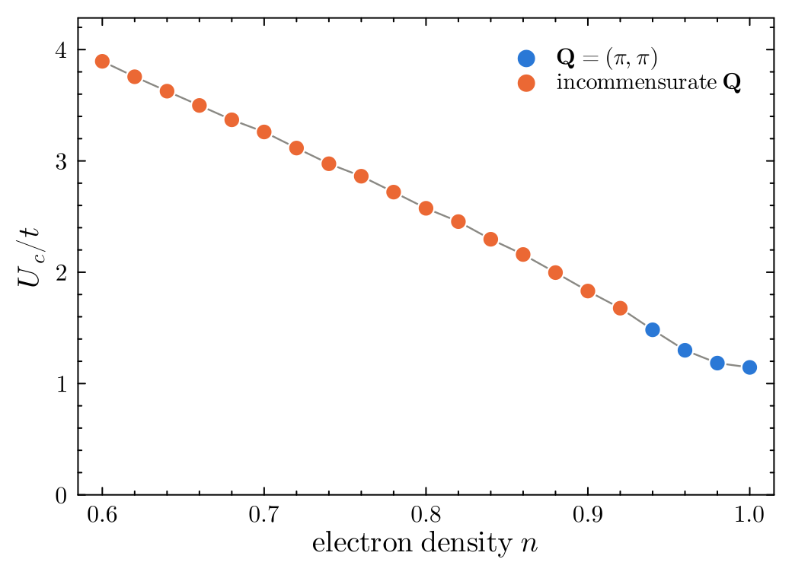
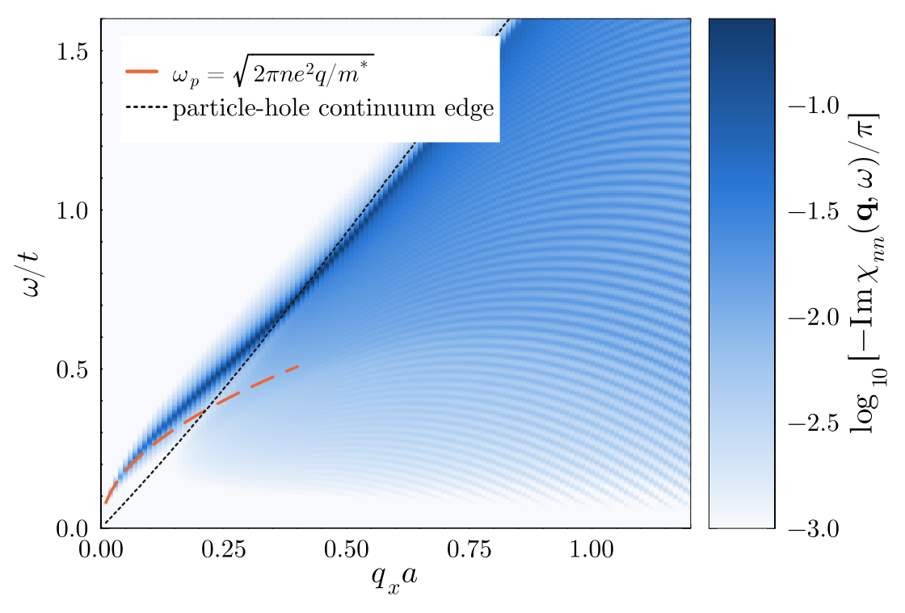

# RPAToolkit.jl

[](https://github.com/Toronto-Condensed-Matter-Theory/RPAToolkit.jl/actions/workflows/CI.yml?query=branch%3Amain)
[](https://Toronto-Condensed-Matter-Theory.github.io/RPAToolkit.jl/dev/)
[](LICENSE)

RPAToolkit.jl is a Julia package for the random phase approximation (RPA) on lattice models.
It computes the bare susceptibility of a tight-binding model, statically or at real frequency.
For any set of two-body interactions, the static RPA then finds the strength at which the system first goes unstable, and at which ordering wavevector.
The dynamic RPA follows collective modes such as magnons and plasmons.

<p align="center">
  
</p>

## Installation

RPAToolkit.jl is not yet in the General registry. Install it from GitHub:

```julia
] add https://github.com/Toronto-Condensed-Matter-Theory/RPAToolkit.jl
```

Everything is Julia.

## Quick start

A run is driven by a YAML config (inverse temperature, k-grid, fillings, k-path) and two files the script writes: the model and the interactions.
From a checkout of this repository:

```julia
using RPAToolkit, TightBindingToolkit, JLD2

config = "examples/Square/Square.yml"      # β, k-grid, fillings and k-path
input = load_rpa_input(config)
mkpath(input["data_dir"])

# the square lattice with nearest-neighbour hopping t = -1, the same for both spins
square() = (uc = UnitCell([[1.0, 0.0], [0.0, 1.0]], 2); AddBasisSite!(uc, [0.0, 0.0]); uc)
uc = square()
t1 = Param(-1.0, 2)
AddIsotropicBonds!(t1, uc, 1.0, SpinMats(1 // 2)[4], "t1")
CreateUnitCell!(uc, [t1])
save(input["unitcell"]["julia"], Dict("unit cell" => uc, "parameters" => [t1]))

# two interaction cases: on-site U = 4, and U = 4 plus a 1/r tail out to three lattice spacings
params, cases = hubbard_coulomb_interactions(square(); onsite = 4.0, range = 3.0)
save(input["interactions"], Dict("parameters" => params, "values" => cases,
                                 "unit cell" => square(), "vertex_slots" => VERTEX_SLOTS))

output = run_rpa(config; run_bare = true)  # the bare bubbles, then the static RPA, at every filling

for entry in sort(collect(values(output)); by = e -> e["filling"])
    h = entry["Hubbard"]
    println("filling ", entry["filling"], ": unstable at ", round(h["critical strength"], digits = 3),
            " × U in the ", h["unstable sector"], " channel, Q = ", h["maximum reciprocal momentum"], " (2π/a)")
end
```

At half filling (`filling = 0.5` per spin) the spin channel goes unstable first, at the Néel wavevector `Q = (1/2, 1/2)` in units of the reciprocal vectors.

## Features

**Models and interactions**
* Lattices and hoppings come from [TightBindingToolkit.jl](https://github.com/Toronto-Condensed-Matter-Theory/TightBindingToolkit.jl): any 2D unit cell, with any number of sites and orbitals.
* Interactions are TightBindingToolkit `Param`s in the (N, X, Y, Z) channels, so on-site, inter-site and long-range terms all go in the same way.
  An on-site Hubbard plus `1/r` Coulomb builder is included.
* For multi-orbital models whose orbitals rotate into each other under the point group, the susceptibility and the Kanamori vertex can be put on a symmetry-closed bilinear basis.
* Spin-orbit coupling: the bubble keeps every channel pair the model's spin symmetry allows (all sixteen in general; the {N, Z} and {X, Y} sectors with Ising coupling), and the RPA is solved one spin sector at a time.
  Without spin-orbit coupling, the spinless bubble is used.

**The static RPA**
* The bare bubble is computed in Julia and threaded: either the exact Lindhard sum, or an imaginary-time FFT route on a discrete Lehmann representation that scales as `N_k log N_k` for large grids.
* Several interaction cases run against the same bubbles, over a scan of fillings or chemical potentials, in parallel.
* Outputs: the critical strength, the leading instability and its momentum, the RPA susceptibility, and the screened interaction `V + V χ_RPA V`.

**The dynamic RPA**
* The retarded bubble `χ₀(q, ω + iη)` and the RPA at every frequency, with spectral functions unfolded from supercells.
* An Ewald-summed long-range Coulomb `V(q)` for two-dimensional plasmons.
* On top of [MeanFieldToolkit.jl](https://github.com/Toronto-Condensed-Matter-Theory/MeanFieldToolkit.jl) Hartree-Fock bands, the RPA with the vertex built from the same interaction is time-dependent Hartree-Fock, with exact Goldstone modes in broken-symmetry states.

## Gallery

<table>
<tr>
<td width="50%"><br><em>Bare static spin susceptibility of the triangular lattice over the Brillouin zone, with nearest-neighbour hopping, 0.75 electrons per site and β = 20/t. It peaks at the zone corners K.</em></td>
<td width="50%"><br><em>Critical Hubbard U of the square lattice against electron density, at β = 20/t. The ordering wavevector is (π, π) near half filling and incommensurate further away.</em></td>
</tr>
<tr>
<td width="50%"><br><em>Transverse spin spectral function of the Hartree-Fock Néel state of the square-lattice Hubbard model at U = 8t. The RPA magnon is gapless at Γ and M and lies below linear spin-wave theory (dashed).</em></td>
<td width="50%"><br><em>Loss function of a dilute square-lattice metal (n = 0.1) with 1/r repulsion, from the RPA on Hartree-Fock bands. The plasmon follows the two-dimensional √q law at small q and enters the particle-hole continuum near q ≈ 0.4/a.</em></td>
</tr>
</table>

The figures are regenerated with `julia --project=docs/readme -t 8 docs/readme/figures.jl`.

## Examples

`examples/` has a square, a triangular and a honeycomb lattice with nearest-neighbour hopping, an on-site Hubbard `U` and a `1/r` Coulomb tail.
Each comes with a notebook that plots its results.
From the repository root:

```
julia --project=. -t 4 examples/Square/Square.jl
```

`examples/MeanField/` runs MeanFieldToolkit Hartree-Fock and then the real-frequency RPA on top of it: the magnons of the Hubbard model's Néel state, and the plasmon of a dilute metal with `1/r` repulsion.

```
julia --project=. -t 8 examples/MeanField/Magnons.jl
julia --project=. -t 8 examples/MeanField/Plasmons.jl
```

See [examples/README.md](examples/README.md) for details.

## Documentation

For further details, please refer to the [Documentation](https://Toronto-Condensed-Matter-Theory.github.io/RPAToolkit.jl/dev/).

## Related packages

| Package | Purpose |
|:--|:--|
| [TightBindingToolkit.jl](https://github.com/Toronto-Condensed-Matter-Theory/TightBindingToolkit.jl) | Lattices, tight-binding and BdG Hamiltonians, band structures and response |
| [FixedPointToolkit.jl](https://github.com/Toronto-Condensed-Matter-Theory/FixedPointToolkit.jl) | Fixed-point iteration and mixing schemes for self-consistent equations |
| [MeanFieldToolkit.jl](https://github.com/Toronto-Condensed-Matter-Theory/MeanFieldToolkit.jl) | Self-consistent mean-field theory of interacting lattice models |
| [RPAToolkit.jl](https://github.com/Toronto-Condensed-Matter-Theory/RPAToolkit.jl) | Random phase approximation: instabilities and collective modes |
